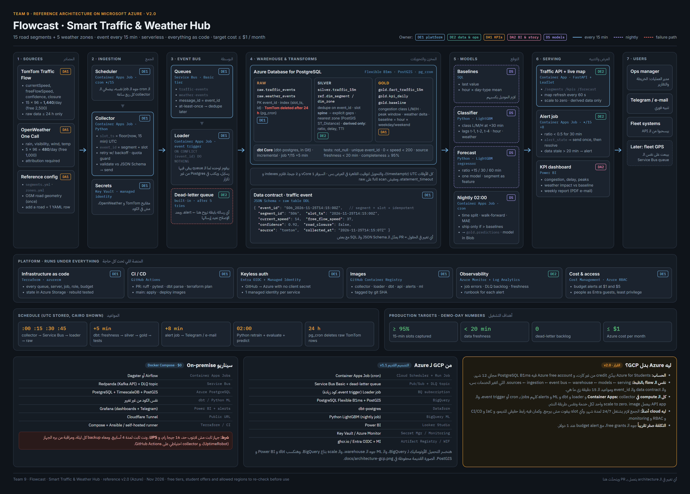

# Flowcast · Smart Traffic & Weather Hub

**Traffic & weather intelligence for delivery fleets.**

Every 15 minutes we record road-segment speeds (TomTom) and local weather (OpenWeather)
for 15 roads in Cairo and Alexandria, then turn them into congestion KPIs, forecasts and
alerts for delivery companies. Serverless on Microsoft Azure, everything as code.



The first design targeted Google Cloud. It is kept for reference in
[docs/architecture-gcp.png](docs/architecture-gcp.png), and the GCP → Azure service mapping is at
the bottom of the new diagram.

## Repository layout

| Folder | What goes there | Owner |
|---|---|---|
| [`config/`](config/) | The 15 road segments and 5 weather zones | DA1 |
| [`collector/`](collector/) | Container Apps Job that calls the APIs and sends events to Service Bus | DE1 + DE2 |
| [`loader/`](loader/) | Event-driven Container Apps Job: Service Bus → PostgreSQL `raw` tables | DE1 + DE2 |
| [`infra/`](infra/) | Terraform for every Azure resource, event schemas (data contract), raw table SQL | DE1 |
| [`dbt/`](dbt/) | SQL transformations: raw → silver → gold, and tests | DE2 + DA1 |
| [`ml/`](ml/) | Python models (LightGBM): baselines, classifier, forecast | DS |
| [`api/`](api/) | FastAPI service and the live Leaflet map | DE2 |
| [`alerts/`](alerts/) | Alert job that sends Telegram / e-mail messages | DE2 |
| [`scripts/`](scripts/) | One-off helpers (probe segments, load reference tables, backfill) | anyone |
| [`docs/`](docs/) | Architecture, timeline, Day 1 checklist, runbook | everyone |

## Azure services

| Need | Service | Cost |
|---|---|---|
| Schedule + run jobs | Container Apps Jobs (cron and event triggers) | monthly free grant |
| Event bus + dead letters | Service Bus **Basic**, 2 queues | cents |
| Warehouse | Azure Database for PostgreSQL Flexible **B1ms** + PostGIS + pg_cron | free 12 months (free account) |
| Transformations | dbt Core (`dbt-postgres`) | free |
| ML | Python (LightGBM) job, models in Blob Storage | cents |
| API + map | Container App (scale to zero) | monthly free grant |
| Dashboard | Power BI | Desktop free, sharing needs Pro |
| Secrets / monitoring | Key Vault / Azure Monitor + Log Analytics | cents / 5 GB free |
| Images | GitHub Container Registry | free |

## Getting started

```bash
python -m venv .venv
# Windows: .venv\Scripts\activate   ·   macOS/Linux: source .venv/bin/activate
pip install -r requirements-dev.txt
ruff check .
pytest
```

Then follow [docs/day1.md](docs/day1.md).

## How we work

- Branch from `main`: `feature/<short-name>`. One pull request per task, reviewed by one teammate.
- No manual changes in the Azure portal after D3: change Terraform instead.
- API keys live in Key Vault only. Never commit keys or paste them in chat.
- Timeline: [docs/timeline.png](docs/timeline.png)
